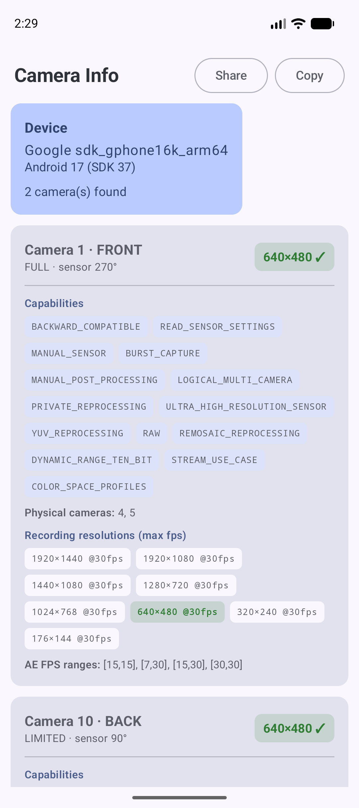

# Android Camera Info — Camera2 Capabilities & Supported Resolutions Probe

[](https://www.android.com)
[-blue.svg)](https://developer.android.com)
[](https://kotlinlang.org)
[](https://developer.android.com/jetpack/compose)
[](LICENSE)

A lightweight, open-source Android developer tool that **lists every camera on a device and dumps its full Camera2 capabilities** — supported video recording resolutions, maximum frame rate per resolution, hardware support level, sensor orientation, high-speed (slow-motion) video modes, AE FPS ranges, logical/physical camera mapping, and more.

Built with **Kotlin** and **Jetpack Compose (Material 3)**. **No camera permission required** — the app only reads camera characteristics, it never opens the camera.

---

## 🔍 Why this app?

When building camera apps with **Camera2, CameraX, or MediaRecorder**, the hardest device-specific questions are:

- *"Which video resolutions can this phone actually record?"*
- *"Does the back camera support 640x480, or will my capture silently fall back to 480x352?"*
- *"What is the max FPS at each resolution?"*
- *"Is this a LEGACY, LIMITED, FULL, or LEVEL_3 hardware device?"*
- *"Which physical cameras sit behind this logical multi-camera?"*

**Android Camera Info** answers all of them in one glance — no `adb` commands, no logcat digging, no writing a test harness.

## ✨ Features

- 📷 **Camera count & per-camera detail** — front, back, and external cameras
- 🎥 **All MediaRecorder recording resolutions** with the **maximum FPS** each supports
- ✅ **Instant 640×480 verdict badge per camera** — green when supported, red with the closest higher fallback when not
- 🧠 **Hardware support level** — LEGACY / LIMITED / FULL / LEVEL_3 / EXTERNAL
- 🧭 **Sensor orientation** in degrees (critical for rotation handling)
- ⚡ **High-speed (slow-motion) video sizes** and their FPS ranges
- 🎯 **AE target FPS ranges** (e.g. `[7,30]`, `[30,30]`)
- 🔗 **Logical → physical camera IDs** (multi-camera systems, e.g. ultrawide + main)
- 🧩 **Full capability flags** — RAW, MANUAL_SENSOR, BURST_CAPTURE, CONSTRAINED_HIGH_SPEED_VIDEO, LOGICAL_MULTI_CAMERA, and more
- 📤 **One-tap Share / Copy report** — send a plain-text report to Slack, email, or bug trackers
- 🎨 Clean **Material 3** card UI with highlighted target resolutions
- 🪶 Tiny footprint, works on **Android 7.0 (API 24) and above**, including Android 12, 13, 14, 15+

## 📱 Use cases

- **QA teams** verifying device camera matrices before testing video recording apps
- **Developers** debugging CameraX `ResolutionSelector` / `ResolutionStrategy` fallback behavior
- **Support engineers** asking users *"just install this and share the report"* when a video capture issue is device-specific
- Anyone comparing camera capabilities across devices and emulators

## 🚀 Getting started

### Download

Grab the latest APK from [Releases](../../releases), or build it yourself:

```bash
git clone https://github.com/<your-username>/AndroidCameraInfo.git
cd AndroidCameraInfo
./gradlew :app:assembleDebug
# APK: app/build/outputs/apk/debug/app-debug.apk
```

### Install & run

```bash
adb install app-debug.apk
```

Open **Camera Info**, scroll through the cards, and tap **Share** to export the full text report.

## 🧪 How it works

The app reads `CameraCharacteristics` via the Android **Camera2 API** (`CameraManager`) without opening any camera device:

- `SCALER_STREAM_CONFIGURATION_MAP` → `getOutputSizes(MediaRecorder.class)` + `getOutputMinFrameDuration()` → resolutions & max FPS
- `INFO_SUPPORTED_HARDWARE_LEVEL` → LEGACY / LIMITED / FULL / LEVEL_3
- `REQUEST_AVAILABLE_CAPABILITIES` → capability flags
- `getPhysicalCameraIds()` (API 28+) → physical cameras behind logical cameras
- `getHighSpeedVideoSizes()` (API 23+) → high-speed / slow-motion modes
- `CONTROL_AE_AVAILABLE_TARGET_FPS_RANGES` → supported FPS ranges

## 📸 Screenshot

<p align="center">
  
</p>

> Card-based report: per-camera verdict badge, resolution chips with max FPS, and full capability list.

## 🛠 Tech stack

| Layer        | Technology                        |
|--------------|-----------------------------------|
| Language     | Kotlin                            |
| UI           | Jetpack Compose + Material 3      |
| Camera data  | Android Camera2 API               |
| Min SDK      | 24 (Android 7.0)                  |
| Build        | Gradle (Kotlin DSL), AGP          |

## 🤝 Contributing

Issues and pull requests are welcome — especially new probe sections (e.g. `ImageReader` formats, RAW sizes, extension modes) or translations.

## 📄 License

MIT — see [LICENSE](LICENSE).

---

### Keywords

android camera info, camera2 capabilities, android camera supported resolutions, android camera recording sizes, camera fps list android, camera hardware level checker, legacy limited full level 3, CameraX resolution fallback, camera characteristics viewer, android camera probe, 640x480 camera support, high speed video sizes android, sensor orientation checker, logical physical camera ids, camera debugging tool, QA camera test app, android video recording tester
